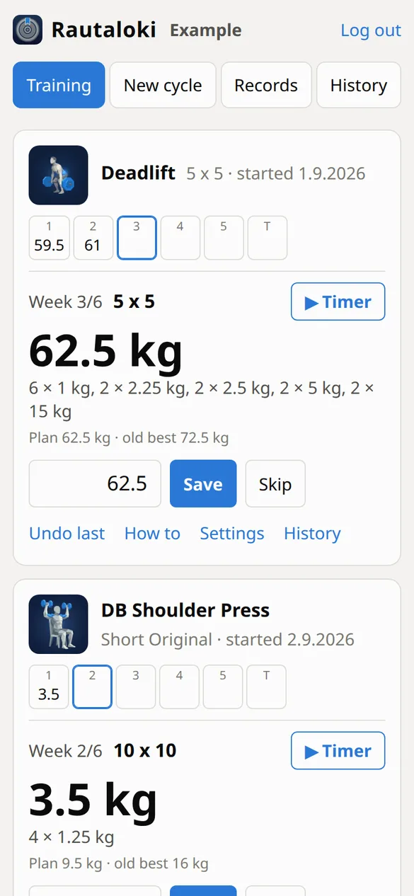
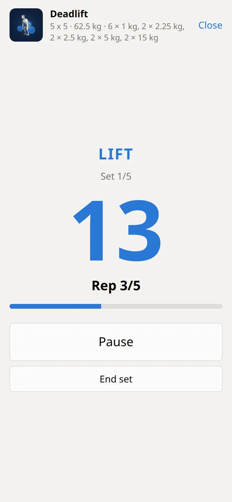
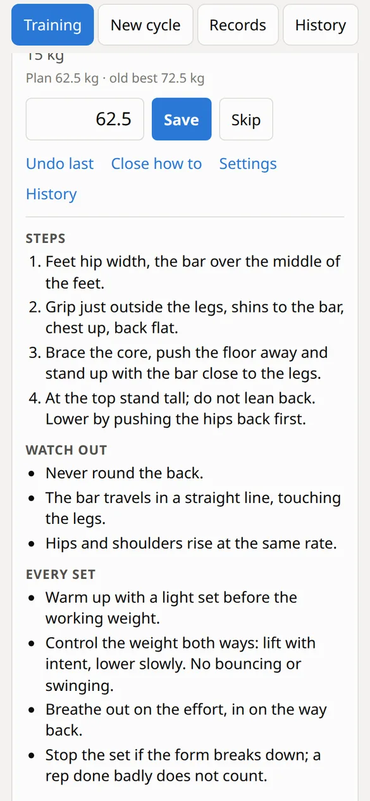
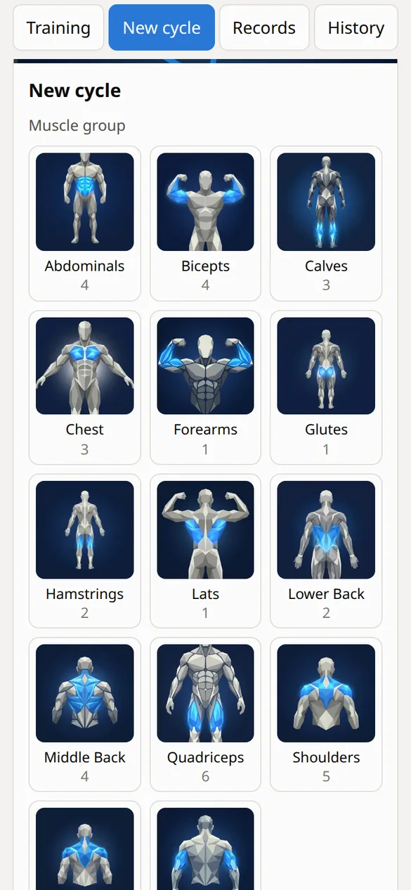
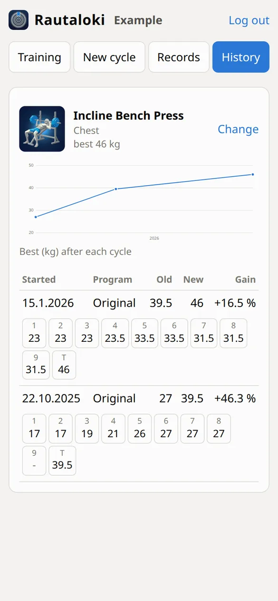
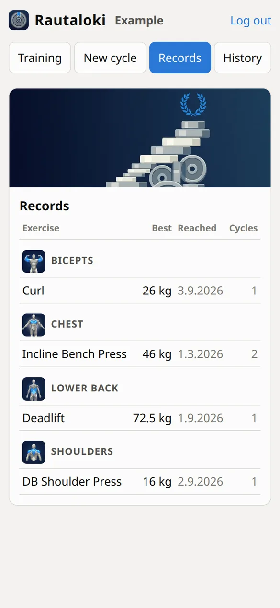

# Rautaloki

Weight training log for a few users. Each exercise is trained in **cycles**: a program of
weekly schemes (e.g. *Original*: 4 × "10 x 10", 2 × "2 x MAX", 3 × "4 x 10", TEST)
run from the exercise's **old best**, ending in a test week that sets the new best.

<p>
  
  
  
</p>
<p>
  
  
  
</p>

Screenshots show the made-up example user from `fixtures/`.

## Running

```bash
npm install
cp -r fixtures data   # first time only: reference data and an example user
npm run dev     # API on :8910 (node --watch) + Vite UI on :5173, proxied
npm run build   # typecheck + build the UI into dist/
npm start       # production: one process on :8910 serving dist/ and the API
npm test        # rule tests on fixtures/, plus a consistency check of data/ if present
```

Node ≥ 24 runs the TypeScript server directly (type stripping), so only the UI
has a build step. Settings are env vars: `PORT` (8910), `HOST` (0.0.0.0),
`RAUTALOKI_DATA` (./data).

Users log in with a **name and password**. Names match case-insensitively, and an
unknown name can be created as a new user from the login screen, with the password
given there (at least 8 characters). Each user can read and write only their own file.
The session is an HttpOnly cookie holding a token signed with `data/secret` (created on
first start; deleting it logs everyone out), and it is also marked Secure when the
request arrives through an HTTPS proxy (`X-Forwarded-Proto: https`). After 5 wrong
passwords in a row a user's login is held off for a minute per attempt.

Set or change a password from the shell, which also ends that user's old sessions:

```bash
node server/passwd.ts <name>    # asks for the password; RAUTALOKI_DATA as for the server
```

### Docker

```bash
docker build -t rautaloki .
docker run -d -p 8910:8910 -v "$PWD/data:/data" rautaloki
```

The image runs as uid 1000 with the data in `/data`. Put it behind an HTTPS proxy
before exposing it to the internet.

## Data

Plain JSON files with no database. **`data/` is not in git**: it is personal, and this
repository is public. Back it up separately. `fixtures/` holds the same reference files
and a made-up example user, for tests and for starting fresh.

The server rewrites a whole file atomically (temp file + rename) and is their only
writer, so run one instance only.

| File | Content |
|---|---|
| `data/catalog.json` | exercises: main/other muscles, equipment, level, reference URL |
| `data/programs.json` | programs: per week a scheme and a percentage of the old best |
| `data/weights.json` | loadable weights per equipment kind with the plates that make them |
| `data/users/<id>.json` | one user: name, all their cycles and timer tempo per exercise |
| `data/passwords.json` | scrypt password hashes by user id, never sent to the UI |
| `data/secret` | the key session cookies are signed with |

A cycle stores `scores`, one per program week: kg lifted, `"-"` for a skipped
week, `null` for not done yet. Records, improvements and the next proposal are
derived from these, never stored. Saves carry the file's ETag (`If-Match`), so a
stale tab gets a 412 instead of overwriting another device's entry.

New users are created from the login screen as `data/users/<id>.json`, with the id
derived from the name.

## Rules

All in `shared/training.ts`:

- **target** for week *w* = old best × program % of week *w*, rounded to the nearest 0.5 kg
- **performance** of a done week = kg lifted / that week's target
- **proposal** for the current week = target × best performance so far + adjustment, rounded to the nearest 0.5 kg
- **load** = the heaviest weight in the equipment's table not above the proposal,
  shown as the plates to put on. Barbell 7 kg, dumbbell handle 1 kg; equipment
  kind is chosen from the catalog in this order: Barbell, Dumbbells (pair),
  Dumbbell (single), other
- **new best** = max(old best, test result); a skipped test keeps the old best

## Timer

The ▶ Timer button on a training card runs the week's sets and speaks the calls aloud
(browser speech synthesis, English), with the timings of the old time2xercise timer
(`shared/timer.ts`): 15 s to get ready, a "lift" per repeat every 5 s (3 s when *fast*,
7 s for doubles) with the last three counted down "3, 2, 1", "relax" at the end of a
set, and the next round announced 6 s before a rest ends. Rest is 1 min in 10-set work,
3 min for singles and MAX sets, otherwise 2 min. MAX and TEST sets run until *Set done*
is tapped. The screen is kept on while the timer is open.
The tempo is set per exercise with − / + on the timer's start screen, in steps of 10 %
of the seconds per repeat; it is kept in the user's file as `tempo`, by exercise id.
